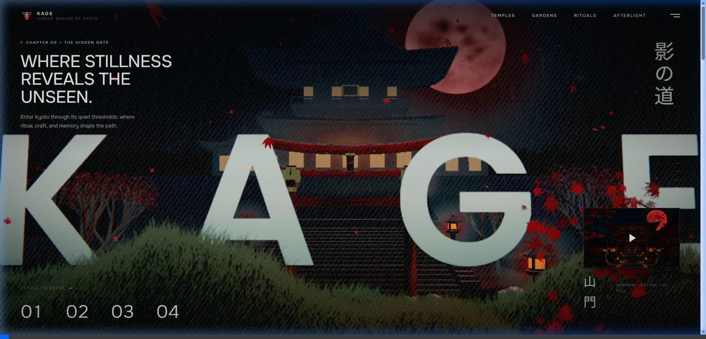

# 🏯 Kage - 3D WebGL Landing Page

A modern WebGL / 3D Landing Page built with **React**, **Three.js / WebGL**, and **Vite**. The website features an interactive 3D environment of Japanese temple architecture (Kyoto), fully generated via procedural algorithms and custom shaders (GLSL) for maximum performance and lightning-fast loading speeds.

---

## 📽 Demo Recording



---

## 🛠 Installation & Setup

### System Requirements
- **Node.js**: >= v18.0.0
- **Package Manager**: `bun` (recommended) or `npm` / `yarn`

### 1. Install Dependencies
```bash
bun install
```

### 2. Start Development Server
```bash
bun run dev
```
Access the application at: `http://localhost:5173/`

### 3. Build for Production
```bash
bun run build
```
The optimized production build will be generated in the `dist/` directory.

### 4. Preview Production Build
```bash
bun run preview
```

---

## 📖 Usage Guide

1. **Experience the 3D Environment**:
   - Visit the homepage to observe the 3D Sanmon temple scene featuring a vermilion moon, falling maple leaves, and real-time volumetric fog.
2. **Scroll Interaction (Camera Movement)**:
   - Scroll down to seamlessly move the camera deep into the 3D scene, transitioning and revealing content for each Chapter.
   - Scroll back up to return to the main interface.
3. **Navigation Bar**:
   - Quickly jump to specific sections using the top-right menu: *Temples*, *Gardens*, *Rituals*, *Afterlight*.
